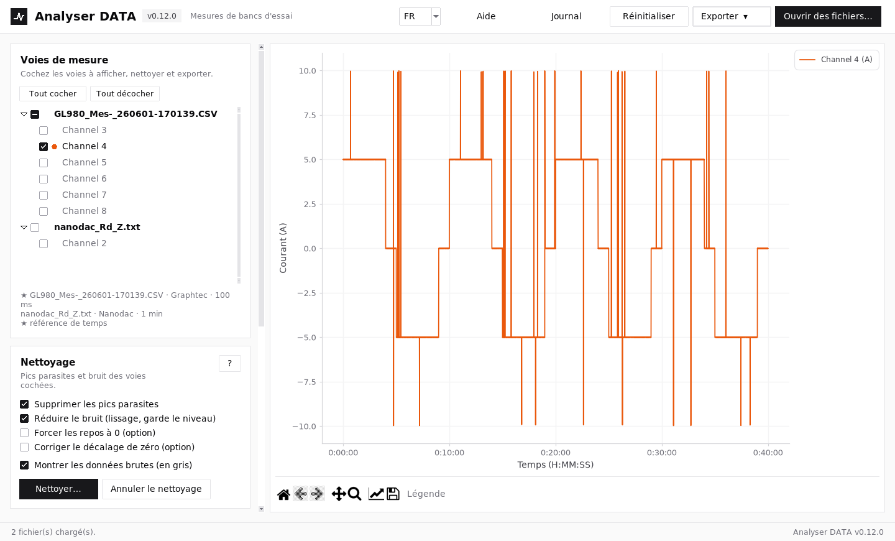
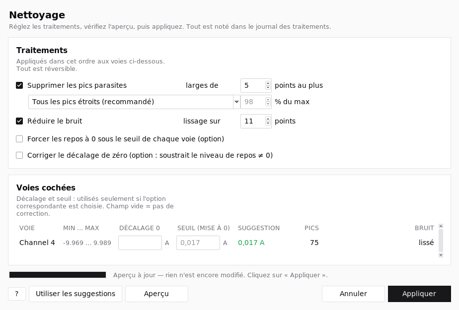
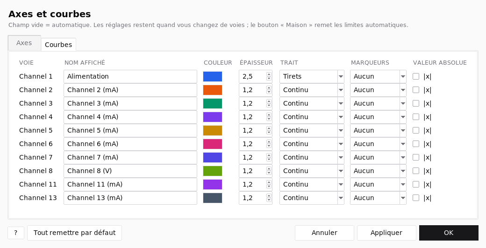
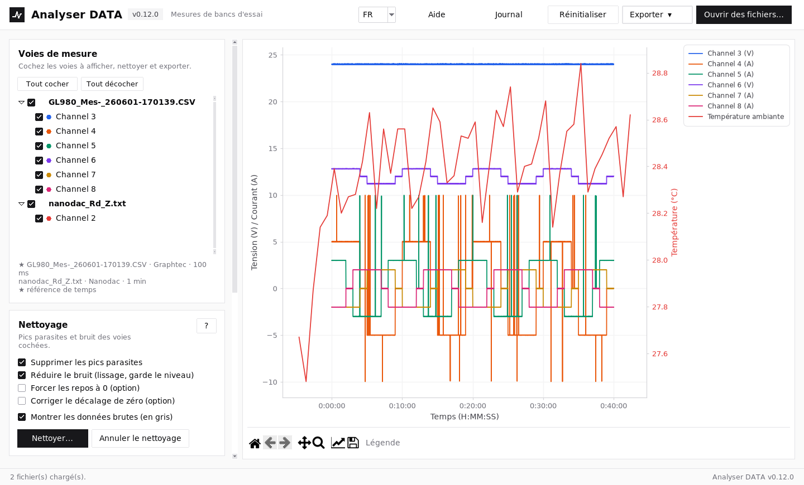

# Analyser DATA

Analyser et nettoyer les mesures de bancs d'essai **sans déformer le signal**.
Application Python (Tkinter + Matplotlib) qui se lance avec **F5 dans Spyder**.

*Anciennement « CleanTrace ».*

Importe les fichiers de plusieurs centrales (Graphtec, Nanodac, Graphset, enceinte
climatique…), les recale sur un même axe temps, supprime le bruit et les pics de
saturation, puis exporte un CSV propre.


*Avant : pics parasites à ±10 A.*


*Après « Nettoyer » : pics retirés, bruit lissé, créneaux intacts ; l'original reste visible en gris.*

---

## Lancer l'application

### Avec Spyder (Anaconda)

1. Télécharger le projet : **Code → Download ZIP** sur
   [github.com/pabios/analyser-data](https://github.com/pabios/analyser-data), puis dézipper.
2. Dans Spyder : **Fichier → Ouvrir… → `main.py`**.
3. Appuyer sur **F5**.

Rien à installer : Anaconda contient déjà tout.

### Sans Anaconda

```bash
pip install -r requirements.txt
python main.py
```

---

## Utilisation

1. **Ouvrir des fichiers…** (essayer ceux du dossier `exemples/`).
2. Cocher les voies à afficher (elles portent le nom de la centrale : « Channel 4 » ; légende
   « Channel 4 (A) », température « Température ambiante » en rouge).
3. **Nettoyer…** : supprime les pics parasites (quelle que soit leur hauteur) et **lisse le bruit
   sans changer le niveau mesuré** (les créneaux restent verticaux, rien n'est mis à 0). En option :
   forcer le repos à 0 sous un seuil calculé sur les données, corriger un décalage de zéro. La
   fenêtre montre l'aperçu **avant** d'appliquer ; « Montrer les données brutes » affiche ensuite
   l'original en gris. Bouton **?** / **Aide** : explications détaillées.

   
4. **Clic gauche** sur un point abîmé pour le corriger (interpolation avec ses voisins).
5. Curseur **Décalage enceinte climatique** : recale les courbes du nanodac si l'enceinte est en retard.
6. Icône **Modifier les axes et les courbes** (barre d'outils du graphique) : titre, début / fin
   du temps en H:MM:SS, min / max / titre / échelle log de chaque axe Y, nom, couleur, épaisseur,
   trait et **valeur absolue |x|** de chaque voie, position de la **légende** (toujours hors
   des courbes : droite, haut, bas ; bouton « Légende » pour la masquer). Gardé jusqu'au
   bouton « Maison ».

   
7. **Exporter ▾** :
   - **Données nettoyées (CSV + journal)** : fichier `;` prêt pour Excel, avec un fichier
     `…_journal.txt` qui trace tous les traitements appliqués ;
   - **Image du graphique** (PNG, PDF, SVG) ;
   - **Rapport PDF pour le client** : fichiers sources, statistiques par voie, graphique,
     journal des traitements.

### Superposer plusieurs fichiers

Réglage **Base de temps** :

| Mode | Quand l'utiliser |
|---|---|
| Heure réelle | même essai, appareils à l'heure (par défaut) |
| Période commune | même essai : tous les fichiers commencent et finissent ensemble |
| Débuts à 0 | horloges des appareils pas à l'heure |
| Durée étirée (0-100 %) | comparer des essais de durées différentes (le temps est déformé) |

**Grille d'export** : celle du fichier de référence, ou une grille commune (100 ms, 1 s,
10 s, 1 min) pour avoir une valeur de chaque appareil sur chaque ligne du CSV.


*Toutes les voies : V / A à gauche, °C et %HR à droite.*

---

**Langue** : français ou anglais, au choix dans la liste « FR / EN » en haut à droite (mémorisé).

## Formats reconnus

Prévu pour les enregistreurs **Graphtec GL980 / GL860** (export CSV avec bloc
« AMP settings », colonnes Date / Time / us, valeurs hors échelle `+++++++`) et
**Eurotherm nanodac** (date en texte ou en nombre Excel, unité dans le descriptif de voie).
Des maquettes calquées sur de vrais exports sont fournies dans `exemples/`.

Les gros fichiers (plusieurs millions de lignes) sont lus en quelques secondes, avec un
indicateur de chargement.

Les fichiers bruts de l'appareil s'ouvrent directement, sans passer par Excel : séparateur
`,` `;` ou tabulation et décimale `.` ou `,` dans toutes les combinaisons (y compris
`,` + `,`), avec ou sans guillemets, utf-8 / cp1252 / utf-16, fichiers réenregistrés par Excel.
Temps en date/heure, `H:MM:SS`, ms, s ou min. Tout est détecté automatiquement.

Un fichier ne s'ouvre pas ? L'application propose d'en **enregistrer un extrait** (début et fin,
quelques Ko) : joignez-le à une issue.

## Signaler un bug, demander une fonctionnalité

Ouvrir une [issue](https://github.com/pabios/analyser-data/issues) : une user story avec ses
critères d'acceptation, ou une capture du message d'erreur. Vérifier la version affichée dans le
titre de la fenêtre.

---

## Développement

Tout se passe dans Docker : rien à installer sur la machine.

```bash
./dev.sh build   # une fois
./dev.sh test    # tests
./dev.sh gui     # appli dans le navigateur : http://localhost:6080/vnc.html
./dev.sh smoke   # parcours complet de l'interface + captures dans .dev-out/
```

Le code est organisé par fonctionnalité dans `analyser_data/` : `loader` (import),
`cleaning` (nettoyage), `plotting` (graphique), `editing` (clic), `export`, `report` (PDF),
`axes_dialog` (axes et courbes), `app` (interface). Textes anglais : `i18n_en.py`.

## Licence

MIT
